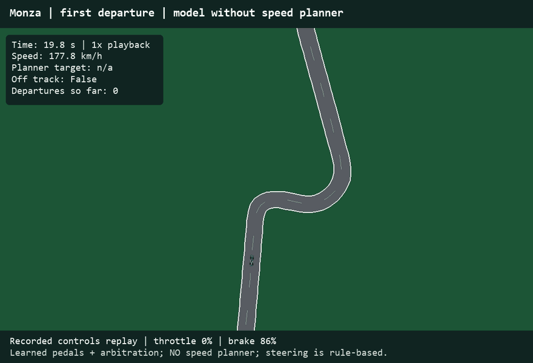
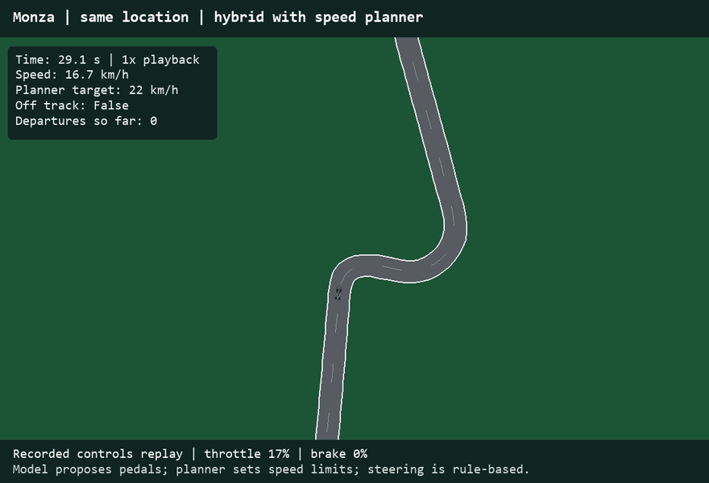
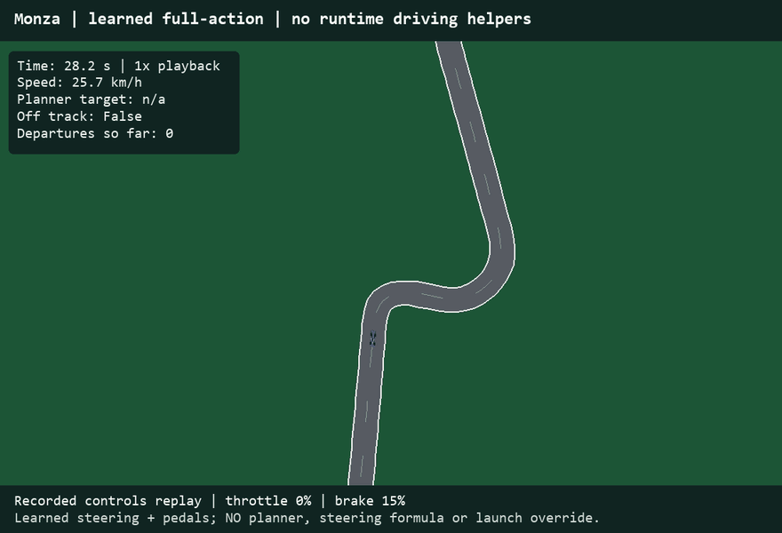

# F1 Driving Lab

Can a computer learn to finish a clean lap? We built a racing simulator to compare three approaches, from learning the pedals to learning every driving control.

<table>
  <tr>
    <th width="33%">1. Learned pedals</th>
    <th width="33%">2. Add speed assistance</th>
    <th width="33%">3. Learned full control</th>
  </tr>
  <tr>
    <td></td>
    <td></td>
    <td></td>
  </tr>
  <tr>
    <td>AI chooses accelerator and brake. Rules still steer and handle launch.</td>
    <td>The same pedal model, with a rule-based planner that slows the car before corners.</td>
    <td>AI chooses steering, accelerator and brake. It copies a simulator teacher during training.</td>
  </tr>
  <tr>
    <td><b>91.8 s — invalid</b><br>13 road departures</td>
    <td><b>205.4 s — clean lap</b><br>0 road departures</td>
    <td><b>209.1 s — clean lap</b><br>0 road departures</td>
  </tr>
</table>

*Recorded simulator replays near the same Monza turn, at real-time playback. They are separate runs, not a synchronized race. Times describe full laps at 0.1-second steps. The full-control driver uses different training examples, so this compares complete systems.*

## Try it

```bash
python -m pip install -r requirements.txt
python -m f1_simulator --track monza --controller learned
```

Use `--controller imitation` or `--controller hybrid` for the other demos. Monza, Silverstone and Spa are bundled. Run checks with `python -m pytest -q`.

Code lives in `f1_simulator/`, training and benchmark commands in `scripts/`, and tests in `tests/`. Generated output stays out of Git.

INSY 674 team project. Simplified simulation, not a claim of real-car performance. Track licenses and data provenance are retained in `data/`. Built from our [original team project](https://github.com/amani-1110/INSY-674-Project).
